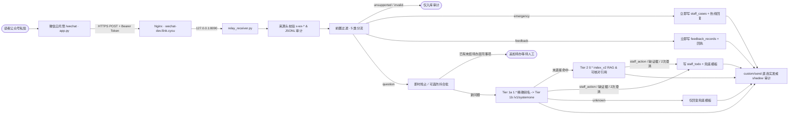

# 汕头大学图书馆公众号 AI 客服后端与云托管转发管道

本项目为汕头大学图书馆微信公众号/服务号 AI 自动客服与工单转接系统，采用**「微信云托管极简转发 + 自建服务器全栈处理」**两段式架构：

- **微信云托管入口（[app.py](app.py) / [Dockerfile](Dockerfile)）**：只负责接收微信云托管消息推送（`/wechat`，含 `CheckContainerPath` 探测），以最小 `2` 项环境变量配置同步转发到自建服务器，不运行大模型检索也不存储读者数据。
- **自建服务器后端（[relay_receiver.py](relay_receiver.py) + [support_backend/](support_backend/)）**：运行于 `wechat-relay.service`（Nginx HTTPS 域名 `wechat-dev.llink.cyou`），完成来源头校验、Filter 预分类、SQLite WAL 持久化（`SCHEMA_VERSION=3`）、即时抢占 / 可选防抖合并、Tier 1 精确别名与 `/v1/systemone` 决策路由、Tier 2 仅 `0.` 公开语料 RAG 引用生成、单次澄清上限、紧急热线/`Fallback` 馆员待办兜底，以及直连微信客服消息 API（`custom/send`）回复。

> [!NOTE]
> 早期直接在云托管内运行 `RagResponder` 的方案及旧单机服务（`wechat-dev-test.service`）仅保留作应急回滚；离线 PoC CLI 说明见 [rag-poc/README.md](rag-poc/README.md)。

---

## 核心架构与请求链路



---

## 目录结构

| 路径 | 职责 |
|---|---|
| [app.py](app.py) | 微信云托管入口；检测到 `WECHAT_FORWARD_URL` 且无 `WECHAT_TOKEN` 时自动进入纯转发模式。 |
| [relay_receiver.py](relay_receiver.py) | 自建服务器 FastAPI 服务：Bearer 鉴权、`x-wx-*` 校验、JSONL 备份、`/relay/send-test` 与 `/relay/support/*` 管理接口。 |
| [support_backend/schema.py](support_backend/schema.py) | SQLite DDL（`SCHEMA_VERSION=3`）与序列化工单/批次/澄清快照结构。 |
| [support_backend/db.py](support_backend/db.py) | 线程安全 SQLite WAL 存储（`inbound_events`、`merge_batches`、`staff_cases`、`feedback_records`、`clarification_states`、`triage_runs`、`outbound_replies`）。 |
| [support_backend/filters.py](support_backend/filters.py) | 5 类消息分类器及 `Same Unresolved Staff Case?` 未结工单续接判定。 |
| [support_backend/pipeline.py](support_backend/pipeline.py) | 异步调度器：支持默认即时抢占重跑（`SUPPORT_MERGE_ENABLED=false`）与传统 3s/10s 防抖模式（`true`）、重启恢复及白名单发信。 |
| [support_backend/presets.py](support_backend/presets.py) | 解析 `1.*.md` YAML frontmatter、`NFKC` 归一化整句匹配与别名冲突检查。 |
| [support_backend/decision_client.py](support_backend/decision_client.py) | `decision-model-preview` `/v1/systemone` HTTP 客户端（默认超时 `3.0s`）。 |
| [support_backend/knowledge.py](support_backend/knowledge.py) | 仅收录 `0.*.md` 的建库 CLI（`rag-poc/index_v2/`）、段落/小节元数据保留、NLTK 单硬链隔离及可核对长短引用格式化。 |
| [support_backend/responder.py](support_backend/responder.py) | Tier 1a -> Tier 1b -> Tier 2 -> 澄清上限与待办兜底编排，`generation` 提交屏障前只计算、提交后写库发信。 |
| [support_backend/shared.py](support_backend/shared.py) | 环境变量解析、UTF-8 边界截断与日志脱敏公共辅助函数。 |
| [rag-poc/](rag-poc/) | 语料库（11 份文档：`0.*` 5 份、`1.*` 3 份、`9.*` 3 份）、`uv.lock` 运行环境及离线 PoC CLI。 |
| [data/Questions.md](data/Questions.md) | 脱敏整理的近一个月公众号私信样本（86 条；运行期原始 `relay-events.jsonl` 等仍忽略）。 |
| [deploy/](deploy/) | Nginx 反代配置（[nginx-wechat-dev-test.conf](deploy/nginx-wechat-dev-test.conf)）与服务器环境模板（[wechat-relay.env.example](deploy/wechat-relay.env.example)）。 |
| [docs/](docs/) | 设计蓝图、各阶段实施文档与数据集规划（详见下文文档索引）。 |

---

## 环境变量与部署

### 1. 微信云托管（仅保留 2 项）

在微信云托管绑定 GitHub 仓库（分支 `main`、端口 `80`、路径 `/wechat`、消息格式 JSON）后，控制台只需配置：

```ini
WECHAT_FORWARD_URL=https://wechat-dev.llink.cyou/relay/wechat
WECHAT_FORWARD_TOKEN=<与服务器 RELAY_AUTH_TOKEN 一致>
```

云托管端无需设置 `WECHAT_TOKEN`、`WECHAT_APP_ID`、`WECHAT_APP_SECRET`、`WECHAT_CLOUD_PUSH_ENABLED`、`WECHAT_AUTO_REPLY_ENABLED`、`DASHBOARD_ENABLED`、`WECHAT_CLOUD_EXPECTED_*` 或 `RAG_*`。

### 2. 自建服务器（统一配置 `/etc/wechat-relay.env`）

生产服务 [wechat-relay.service](wechat-relay.service) 使用 `DynamicUser=yes` 与只读挂载，并从唯一 `EnvironmentFile=/etc/wechat-relay.env`（权限 `0600`）读取全部密钥与运行参数；完整模板见 [deploy/wechat-relay.env.example](deploy/wechat-relay.env.example)：

| 分组 | 关键环境变量 |
|---|---|
| 转发鉴权与云来源校验 | `RELAY_AUTH_TOKEN`、`WECHAT_CLOUD_EXPECTED_SOURCE`、`WECHAT_CLOUD_EXPECTED_ENV`、`WECHAT_CLOUD_EXPECTED_APPID` |
| 微信客服 API 凭证 | `WECHAT_APP_ID`、`WECHAT_APP_SECRET` |
| 模型与向量检索 | `SUPPORT_DECISION_BASE_URL`、`SUPPORT_DECISION_API_KEY`、`RAG_LLM_*`、`RAG_EMBEDDING_*` |
| 调度与发信灰度开关 | `SUPPORT_AUTO_REPLY_ENABLED`、`SUPPORT_AUTO_REPLY_ALLOWLIST`、`SUPPORT_MERGE_ENABLED`（默认 `false`）、`SUPPORT_IMMEDIATE_MAX_PREEMPTS`（默认 `2`） |

### 3. 日常运维与重建 `0.` 索引

```bash
# 仅对 0.*.md 语料重建 Tier 2 向量索引（离线载入 rag-poc/.env）
rag-poc/.venv/bin/python -m support_backend build-index \
  --corpus rag-poc/corpus \
  --index-dir rag-poc/index_v2 \
  --env-file rag-poc/.env

# 重启并检查线上主服务（改过 unit 文件时需先执行 sudo systemctl daemon-reload）
sudo systemctl restart wechat-relay.service
curl -fsS -H "Authorization: Bearer $RELAY_AUTH_TOKEN" \
  "https://wechat-dev.llink.cyou/relay/support/overview"
```

---

## 接口清单（[relay_receiver.py](relay_receiver.py)）

除 `GET /healthz` 外，所有 `/relay/*` 接口均强制校验 `Authorization: Bearer <RELAY_AUTH_TOKEN>`：

| 方法与路径 | 用途 |
|---|---|
| `GET /healthz` | 存活探针，返回 `ok` |
| `POST /relay/wechat` | 接收云托管转发包、校验 `wx_headers`、写 JSONL 与 SQLite 并异步处理 |
| `GET /relay/events` | 查看最近原始转发记录（`limit=1..100`） |
| `POST /relay/send-test` | 按 `seq` 或 `to_user` 测试直连 `custom/send` |
| `GET /relay/support/overview` | 运营汇总计数（脱敏：不含 OpenID 与正文） |
| `GET /relay/support/events` / `batches` / `feedbacks` / `cases` / `replies` / `triage-runs` | 分表结构化检索（支持 `limit=1..200` 及分类/状态筛选） |
| `POST /relay/support/cases` / `cases/{case_id}/close` | 创建或结案馆员待办 |
| `POST /relay/support/flush-due` | 手工冲刷已到期 debounce 批次 |
| `GET /relay/support/presets` | 查看已加载的 `1.` 固定答案及别名清单 |

---

## 安全与数据边界

- **只支持明文转发与直连直发**：云托管 `CheckContainerPath` 直接返回 `200 success` 不外发；自建后端校验 `RELAY_AUTH_TOKEN` 及 `x-wx-source` / `x-wx-env` / `x-wx-appid`。
- **日志脱敏**：运行日志不打印 OpenID、消息正文、凭据或模型完整异常；发信错误仅保留 ASCII 安全 `errmsg`。
- **灰度保护**：`SUPPORT_AUTO_REPLY_ALLOWLIST` 非空时，仅允许测试白名单 OpenID 真实调用微信客服 API，其余读者消息全链路处理并留痕于 `outbound_replies(status='shadow')`。
- **原始数据留存**：`inbound_events` 自动写入 `7` 天过期基准 `expires_at_epoch`，所有 SQLite 文件（`/var/lib/private/wechat-relay/`）与 `.env` 均处于 `.gitignore` 与版本库之外。

---

## 本地测试与回滚

```bash
# 完整支持层 + 云入口测试（含 llama-index 环境）
rag-poc/.venv/bin/python -m unittest discover -s tests -v

# 标准依赖环境兼容性回归（验证 stdlib 回退路径）
./.venv/bin/python -m unittest discover -s tests

# rag-poc 离线 PoC CLI 测试
PYTHONPATH=rag-poc rag-poc/.venv/bin/python -m unittest discover -s rag-poc/tests
```

旧版单机服务 [wechat-dev-test.service](wechat-dev-test.service)（监听 `127.0.0.1:8000`、`location = /wechat`）仅作为应急回滚路径，不参与当前日常流量。

---

## 文档索引

- 系统设计蓝图：[DESIGN.md](docs/DESIGN.md)
- Step 1 · 云托管极简转发与自建环境收敛：[STEP1-CLOUD-FORWARD-PIPELINE.md](docs/STEP1-CLOUD-FORWARD-PIPELINE.md)
- Step 2 · Filter、SQLite 与消息合并/即时抢占管道：[STEP2-FILTER-AND-MERGE-PIPELINE.md](docs/STEP2-FILTER-AND-MERGE-PIPELINE.md)
- Step 3 · Tier 1 `/v1/systemone`、Tier 2 仅 `0.` 检索与澄清/兜底：[STEP3-TIER1-AND-TIER2-RAG.md](docs/STEP3-TIER1-AND-TIER2-RAG.md)
- 数据集与评测规划：[RAG-DATASET-TEST-PLAN.md](docs/RAG-DATASET-TEST-PLAN.md)
- 项目背景与演进决策记录：[BACKGROUND.md](BACKGROUND.md)、[PROGRESS.jsonl](PROGRESS.jsonl)
- 历史参考（归档）：[rag-poc/README.md](rag-poc/README.md)
