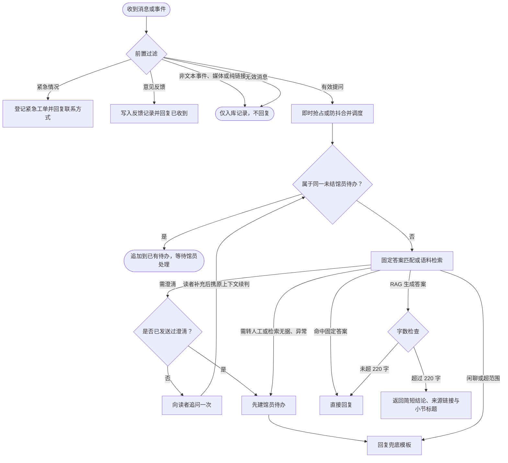
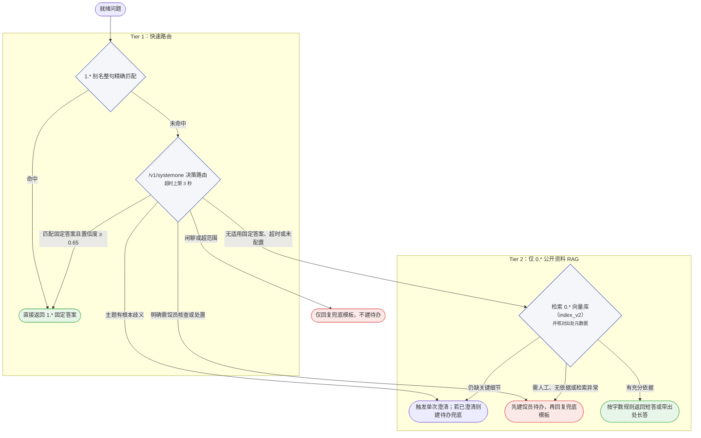
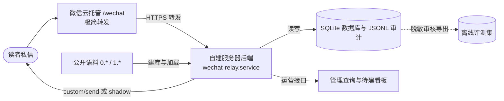

# 图书馆智能客服系统设计

> [!NOTE]
> 当前系统已落地「微信云托管极简转发（`app.py`）+ 自建服务器全栈处理（`relay_receiver.py` + `support_backend/`）」两段式架构，并开启直连客服消息 API（`custom/send`）白名单灰度测试。可视化管理看板与评测集导出将在第 4 步补齐，详见 [README](../README.md)。

## 设计蓝图

整体流程：

分诊与检索流程：

数据流通：

## 细节

### 固定答案、检索与引用

- **Tier 1 精确匹配**：问题进入分诊后，先与 `1.` 固定答案 frontmatter 中的 `aliases` 做整句精确匹配。问题和别名采用同一套归一化（NFKC、首尾去空白、连续空白合并、循环剥离句末标点与符号、大小写折叠），且加载时校验别名无跨文档冲突，命中即直返正文。
- **Tier 1 决策路由**：未命中精确别名时，将问题、澄清上下文及全部 `1.` 答案的 `id`、正文和 `applicability` 发给 `/v1/systemone`（模型 `decision-model-preview`，按线上实测校准为 `3.0` 秒超时）。单次调用同时返回 `route`（`public_qa` / `clarify` / `staff_action` / `unknown`）和 `preset_id`。仅当 `1.` 正文与适用条件能覆盖完整诉求且置信度达到 `0.65` 时直返固定答案。比如「图书延期」可直返续借固定答案，而「图书续借出问题了」因超出适用条件选 `none`，交由 Tier 2 检索排障资料。
- **路由边界与降级**：业务意图明确时直接匹配固定答案或进入 Tier 2，仅在留言过于简略或存在根本歧义时触发澄清。`/v1/systemone` 超时、报错或未配置时自动降级进入 Tier 2。`unknown` 路由仅回复兜底模板、不建馆员待办；`staff_action`、检索无据或异常时均建待办并兜底。
- **Tier 2 检索与出处核对**：向量索引 `rag-poc/index_v2/` 只收录 `0.` 前缀公开文档，不收录 `1.` 固定答案和 `9.` 背景文档。建库时先提取 frontmatter 的 `source` URL 并剥离 YAML 块，用 `MarkdownNodeParser` 按标题拆小节并把当前标题追加到 `header_path` 末尾，再用 `SentenceSplitter(paragraph_separator="\n\n", chunk_size=512, chunk_overlap=80)` 细分长小节。检索默认 `top_k=4`、`min_score=0.2`，剔除模型生成的所有 URL 后严格按命中节点元数据格式化输出；超过 `220` 字的长答仅返回简短结论，并附 `具体请参考 {source} 下的「{section_title}」节。`

### 调度与自动回复时序

- **回调确认与异步发送**：微信云托管 `/wechat` 在 5 秒回调窗口内同步转发至自建服务器 `/relay/wechat`（默认超时 `3.0` 秒、fail-open）并立即返回 `success`；自建后端同步完成 JSONL 与 SQLite 落盘后，在后台异步执行分诊、RAG 检索和发信。[微信回调时限](https://developers.weixin.qq.com/doc/service/guide/product/message/Receiving_standard_messages.md)
- **即时抢占与可选防抖合并**：按 `(account_id, MsgId)` 幂等去重。依据线上读者多为单条提问的分布特征，默认开启即时抢占模式（`SUPPORT_MERGE_ENABLED=false`）：首条 `question` 立刻启动处理；提交前同读者再发新消息且未超上限（默认最多抢占 `2` 次即单轮合入 `3` 条、最长 `10` 秒）时，追加文本并取消旧任务重跑，通过 `generation` 提交屏障防重发，超限后锁批并将后续消息排入 `queued` 队列。传统「静默 `3` 秒 / 最长 `10` 秒」防抖合并保留为 `SUPPORT_MERGE_ENABLED=true` 可选开关。
- **直连回发与灰度控制**：已取消云托管侧发信，改为自建后端直连微信 `custom/send`（单条消息上限 `1800` UTF-8 字节），并已完成真机送达验收。线上通过 `SUPPORT_AUTO_REPLY_ENABLED` 与 `SUPPORT_AUTO_REPLY_ALLOWLIST` 控制灰度：白名单内 OpenID（含静态环境变量白名单与通过 `SUPPORT_GRAY_ENROLL_KEYWORD` 私信口令动态入组的持久化读者；口令仅由服务端环境变量配置，未设置时默认关闭）实发，其余读者走完完整流程并以 `status='shadow'` 写入 `outbound_replies`。若微信接口报错或触达发送限额，后端记录错误码后由馆员在公众号后台继续回复。

### 馆员处理

- **人工协同与看板边界**：馆员目前通过微信公众号后台人工回复读者；自建后端已提供 `/relay/support/overview`、`/cases`、`/cases/{case_id}/close`、`/feedbacks`、`/triage-runs` 等查询与结案接口（管理看板页面及是否由看板直连发信将在第 4 步落地）。
- **未结待办追加**：同一读者存在 `open` 状态的 `staff_todo` 时，若新消息命中追问词、关键词重合或处于 30 分钟活跃窗口内（且非明确新主题），则直接追加到 `staff_case_messages` 等待馆员回复与结案，不再重复触发自动问答。
- **单次澄清与先建待办原则**：每个问题最多发送 `1` 次澄清（状态有效期 `30` 分钟），读者补充后携原问题上下文重新判断；若再次判定需要澄清，则改发兜底模板并创建待办。所有需要人工跟进的分支一律先写入 `staff_cases` 再尝试发信，确保发送失败时待办不丢失。
- **发送额度约束**：服务号 `custom/send` 在「用户发送消息」场景下有 48 小时内最多 5 条的额度限制，公众号后台人工回复不计入该额度。若自动回复因额度受限发送失败，`outbound_replies` 记录失败原因，已有待办仍由馆员在后台处理。[微信发送客服消息 API](https://developers.weixin.qq.com/doc/service/api/customer/message/api_sendcustommessage)
