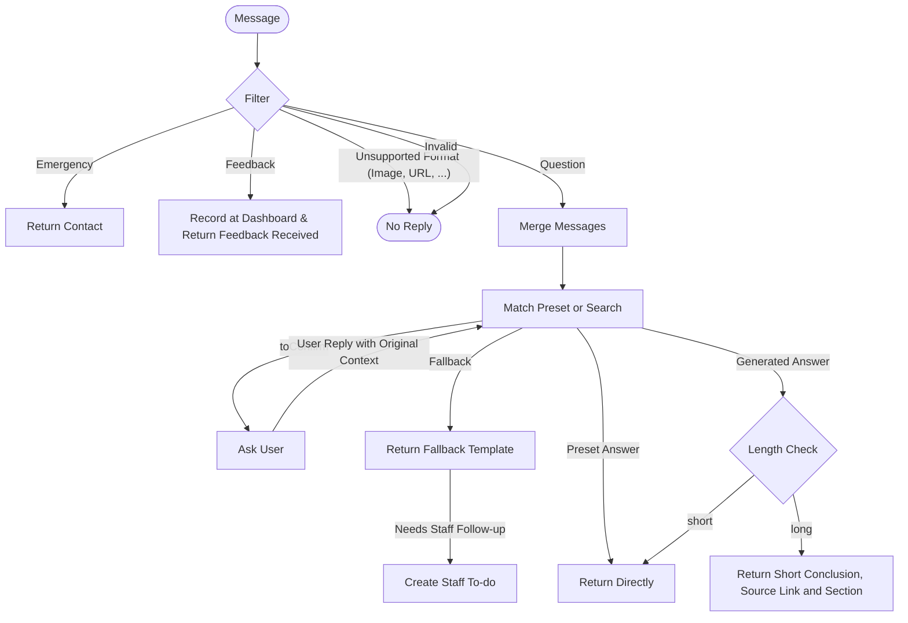
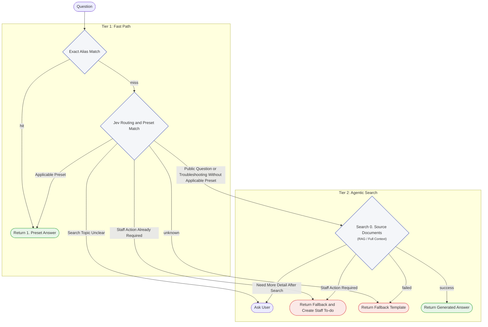
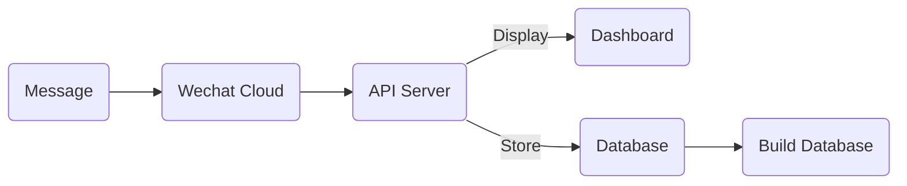

# 图书馆智能客服系统设计

## 设计蓝图

整体流程：

Search 流程：

数据流通：

## 细节

### 固定答案、检索与引用

- 合并普通问题后，先用 `1.` 文档 frontmatter 的 `aliases` 做整句精确匹配。对问题与别名使用同一套归一化，包含 NFKC、首尾去空白、连续空白压成一个空格，以及去除句末常见标点和装饰符号（如问号、感叹号、句号、省略号和波浪号）。归一化后的同一别名只对应一条固定答案，命中且满足适用条件时直接返回正文。
- 精确匹配未命中时，将完整问题、必要的澄清上下文，以及候选固定答案的正文和适用条件交给 Jev。一次调用返回两项 `Choice`，一项判断下一步（公开咨询或通用排障、待澄清、需馆员处理或无法判断），另一项从 `1.` 答案 ID 与「无适用答案」中选择。Jev 只有在正文能回答读者的完整诉求时才选择答案 ID，否则选择「无适用答案」。公开咨询或通用排障的匹配置信度达标时可直返该答案。
- 固定答案由 `0.` 资料整理而来。对于「图书延期」，续借规则和步骤可以直接回答。对于「图书续借出问题了」，当前续借固定答案提供的是办理步骤和资格条件，Jev 应选「无适用答案」，进入 Tier 2 检索公开排障资料。
- 公开咨询或通用排障的检索主题一旦明确，缺少适用固定答案就先走 Tier 2，即使读者还没提供报错详情。检索主题不明确时先澄清。检索后仍缺读者可以补充的关键信息时再澄清。明确需要馆员处理时，直接返回 Fallback 并登记待办。无法判断或检索后缺少可用依据时返回 Fallback。
- Tier 2 的向量索引只收录文件名以 `0.` 开头的原始资料。自动答复的出处引自实际支撑结论的 `0.` 文档小节。
- 读取 `0.xxx` 时，先提取 frontmatter 中已确认的 `source` URL，再剥离整个 YAML 块。正文按 Markdown 小节分块，长小节沿段落边界继续切分。`MarkdownNodeParser` 的默认 `header_path` 保存祖先标题。把当前小节的标题追加到祖先路径，形成引用用的完整 `header_path`。同一小节的所有检索块都保存相同的 `source` 和完整路径。
- `MarkdownNodeParser` 按标题生成小节节点。对过长的小节单独运行 `SentenceSplitter(paragraph_separator="\n\n", chunk_size=512, chunk_overlap=80)`，沿用现有的块大小和重叠默认值，以 Markdown 的单空行为段落边界。单段超过可用块大小时，由 `SentenceSplitter` 继续细分。
- 长答复先给简短结论，再附「具体请参考 [LINK] 下的 xxx 节。」`[LINK]` 使用引用元数据中的 URL，`xxx` 使用完整路径末尾的当前小节标题。页面提供可定位的小节锚点时，可以直接链接到小节。

### 馆员处理

馆员在微信公众号后台回复读者，在自有服务器的 Dashboard 查看待办并登记处理结果。Dashboard 发信和自有服务器回调微信的链路待后续确认。

同一事项有未结待办时，将读者的补充消息追加到该待办，交给接手的馆员继续回复。接手馆员在 Dashboard 记录结果和结案。能明确识别为新事项的消息仍走正常流程。

服务号的发送客服消息 API 在「用户发送消息」场景下有 48 小时内最多 5 条的额度。微信公众号后台人工回复独立于这项额度。若后续 Dashboard 通过该 API 发信，其消息与自动回复一起计入额度。若微信因额度拒绝自动发送，Dashboard 记录发送失败，已有待办由馆员继续处理。[微信发送客服消息 API](https://developers.weixin.qq.com/doc/service/api/customer/message/api_sendcustommessage)
