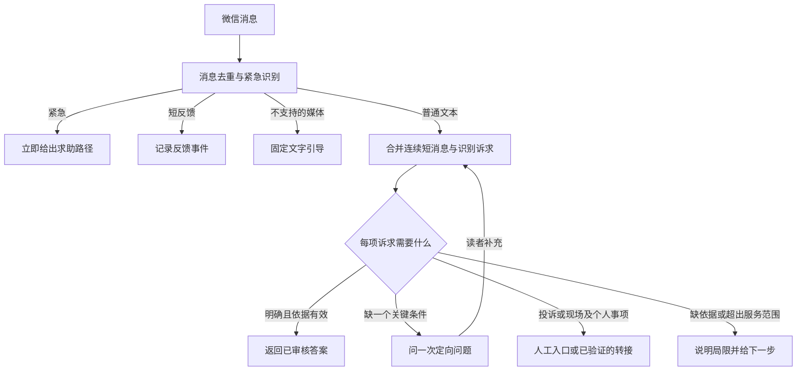
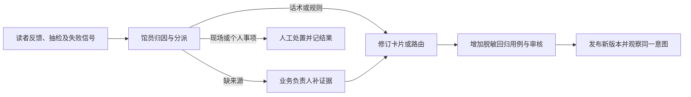

# 图书馆智能客服设计提案

## 1. 推荐方向

**首期用意图路由、馆员审核的标准答案和人工处理入口。RAG 保留为离线对照，只有在合格答复覆盖率有明确增益时，再按主题开放给读者。** 客服的基本任务是判断读者当前需要什么帮助，再决定答复、澄清、联系馆员或提示紧急求助。检索只是其中一种提供答案的方式。

最小版本用本地规则识别明确说法和菜单入口，命中卡片就返回固定正文。模糊请求问一个简短问题，其余展示已核实的联系路径。系统运行范围限图书馆公开信息、自助操作指引和人工衔接。个人借阅状态、账户权限、扣款原因和现场处置由工作人员核实。

这个方案依赖馆员能维护少量答案和联系路径。先指定负责人并试审高频卡片。来源过期、冲突或渠道无人值守时，缩小自动答复范围。上线前由业务负责人确认值班覆盖、紧急联系方式和数据保留期限。

## 2. 读者样本与新版 corpus

[读者样本](Questions.md)有 87 条非空消息。若每个连续非空段落代表一次会话，则有 5 组，范围为第 1–34、36–38、40–63、65–66、68–91 行。若只有第 36–38 和 65–66 行是连发、其余各行独立，则有 84 组。文件无法确认这两种解释对应的真实读者边界。下表用同一批主题标注分别计数，各主题可出现在同一组。排序结合消息数、处理成本与业务影响，真实会话频率留待有可靠边界的前向采集。

| 主题 | 消息数 | 含该主题的组数（84 组口径） | 含该主题的组数（5 组口径） | 设计影响 |
|---|---:|---:|---:|---|
| 图书续借 | 14 | 14 | 2 | 多种写法共享一张卡片 |
| 空间预约及使用 | 13 | 13 | 3 | 含研讨室、座位、静音舱和占座，按对象及诉求路由 |
| 其中，静音舱 | 4 | 4 | 2 | “舱”“仓”“苍”归一到同一意图，目前缺操作依据 |
| 开放时间和 24 小时阅览区 | 7 | 7 | 3 | 分开判定日常时段、具体日期和考试周启用 |
| 未明确对象的预约表达 | 5 | 5 | 3 | 确认对象或读取有效的会话上下文 |
| 明确的图书预约和取书 | 3 | 3 | 3 | 分开处理预约条件、取书点与本人预约状态 |

### 按读者想获得的帮助分类

逐条给 87 条消息标一个主要类别。“续借”有明确操作对象和动作，计作办事指引。“知网”等资源名称暂按找入口计。“研讨室”等只说对象且有多个常见下一步的，计作待确认。储物柜连发的最后一句沿用前两句的故障诉求。以下为消息条数。

| 主要诉求 | 消息数 | 样本例子 |
|---|---:|---|
| 查公开信息 | 16 | 闭馆时间、饮水机位置、入馆规则、服务台电话 |
| 找入口、问操作流程 | 36 | 续借、打印、座位预约、查看已借书籍、怎么缴费 |
| 核实个人业务 | 3 | 旧借阅卡是否有效、账号失效、为什么被扣款 |
| 操作失败或需要补救 | 6 | 研讨室约不了、储物柜识别失败、找不到书、图书遗失 |
| 现场处置、投诉建议或联系馆员 | 7 | 座位被占、反映噪声和空调问题、要求联系馆员 |
| 紧急求助 | 1 | 被锁在馆内 |
| 意图待确认 | 18 | 没有上下文的“1”“预约”“使用方法”，以及问候 |

业务主题另标为借阅、空间、馆务设施、账号费用、数字资源等。以空间为例，“怎么预约”是办事指引，“预约不了”是操作失败，“预约了但有人占位”是现场处置。公开信息与办事指引共 52 条，可优先核对其中哪些有资料支撑标准答案。

新版 `rag-poc/corpus/` 共 11 份 Markdown。新增样本覆盖以这批资料为准。馆网服务项目页面的在线请求跳转后超时，本次依据仓库快照梳理。发布时由馆员复核线上菜单、规则适用范围和时效。

| 状态 | 证据与处理 |
|---|---|
| 有可审内容 | 图书续借、常规开放时段、自助借还、查看借阅记录、研讨室与座位预约、登录及密码重置指引、打印和分校区联系方式。续借短文与 FAQ 均明确续借一次、15 天，服务项目补充操作步骤。开馆时间短文与进馆守则的常规和寒暑假时段一致，仍需核验当前版本和临时公告。 |
| 需要核定口径 | 《图书预约》和《常见问题》写“可出借册数少于 0 册”，同句又解释为全部外借。《服务项目》提到已预借但尚未借出也可预约，且按校区区分取书点。由流通业务负责人核对规则和实际界面，再分别发布预约条件与取书卡片。现有材料可供核对，审定前按到馆通知或服务台引导。 [预约短文](../rag-poc/corpus/1.%20图书预约.md) · [常见问题](../rag-poc/corpus/0.%20常见问题.md#书刊借阅-15) · [服务项目](../rag-poc/corpus/0.%20服务项目.md#预约图书) |
| 有规则，缺当前状态 | 考试周开放规则有依据，本次启用日期需核对当期公告。旧证能否使用、账号失效原因、预约失败、扣款争议及个人记录需要馆员或读者中心核实。问“怎么缴费”可用审核后的流程，实际扣款或欠费明细归人工核验。 |
| 缺可执行指引 | 优先补静音舱和储物柜的入口、规则和故障联系路径。饮水机、信息空间、密集书库补分校区位置与路线，虚拟图书馆、知网和网络补入口及适用条件。空调、被困等现场事件由当班渠道处理。网址等泛指先确认读者想找哪个入口。 |

**来源清单。** 沿用评估方案的 corpus manifest 和字段，使用一个版本化 `corpus-manifest.jsonl` 管理来源。先复核《规章制度》误用的《机构设置》标题及 `article-4.html`，在核实真正出处后更正。若由不同官方页面拼成，按出处拆分修订。开馆时间、图书预约和图书续借三份短文缺来源元数据，逐项核对原页面或公众号指南。《咨询台》等标题泛化的摘录也与原文核对。清单以 `(doc_id, revision)` 为键，保存 `title`、`source_url`、`relative_path`、`effective_from`、`effective_to`、`status` 与 `checked_on`。未知日期使用空值，带时效的规则需馆员确认后才能发布。未核实或冲突未解的段落留作审核材料。获批卡片和测试案例都用 `doc_id`、`revision` 与段落定位引用同一快照。 [语料与评估数据契约](RAG-DATASET-TEST-PLAN.md#dataset-structure)

## 3. 微信会话与路由

1. **接入和上下文。** 按微信账号和 `MsgId` 对重投去重。验证回调和完成已启用的有界入站写入后，尽快确认。回复处理在确认后执行，普通消息从同一账号及 OpenID 的首条消息起等待最多 2 秒，窗口内保持静默，按收到的顺序归并并只回复一次。保留最近一次未完成澄清的选项或校区等必要字段，空闲 5 分钟后失效。明确的新主题开启新请求，同一批有两个独立诉求时分别判定动作后合成一条回复。OpenID 只用于受限渠道侧的会话和发信。用授权手机校准窗口。
2. **处理控制消息。** 紧急识别后、普通路由前检查精确的反馈词「有用」「未解决」。完整匹配关联到同一会话最近一条带提示且获微信发送接受的答复，反馈窗口为接受后的 5 分钟，开始下一业务请求时提前关闭。每条答复计最近一次反馈。无关联目标时记未匹配。反馈事件独立于新请求和自动答复。带新描述的文本继续作为咨询处理。对图片、语音、视频等不支持的用户消息，记不支持类型事件，在线模式发送一次固定文字引导，请读者描述问题。若同窗口已有文字，则继续处理文字，只发一条回复。系统事件按事件类型处理。
3. **判定诉求。** 用菜单入口、归一化别名和高精度规则提供候选，保留否定、失败、投诉等语义。“怎么预约”和“预约不了”走不同路径。“预约”可提供图书、研讨室、座位、静音舱等选项。单独收到数字时，只有同会话仍有编号选项才解释为选择。模型分类只有在离线测试证明改进且数据范围已获批时使用，输出仍需通过卡片适用条件和有效期检查。
4. **给出下一步。** 已审核卡片直接返回正文和必要条件。具体日期、校区或人群影响规则时，用已有上下文补齐，否则只问一次，仍不清楚就列可选入口。正文优先给可以执行的第一步，再补限制或来源。简单问候给简短服务入口。缺依据时说明需要核实的内容和渠道。
5. **处理紧急和人工事项。** 疑似被困、受伤等触发独立 `emergency` 路由，立即给出经核验的现场值班或紧急求助路径，附校区及位置提示。该路径跳过归并、检索、模型、澄清和普通队列，取消尚未发出的普通答复，并写入高优先级事件供复核。公开的两个服务台电话供核验，不以其代替夜间值班验收。占座、噪声、空调和设备故障给现场引导。扣款和账号异常给核验入口，公众号对话避免索取密码、验证码、人脸照片或证件号。
6. **采用异步引导衔接人工。** 首期在云托管回调确认后用客服消息给已验证的当班服务台或其他馆员联系路径，由读者联系。后台分别记录提供渠道、请求转接、确认接单和结案。微信原生 `transfer_customer_service` 需要在被动回复时限内对用户消息返回原生转发响应，发出 `success` 后的 `custom/send` 无法完成这一步。若引入原生转接，先在授权环境验证云托管透传、客服账号接入、未接单及会话关闭后恢复回调。这个分支必须在回调时决策，只在验收通过后启用，接单状态以可观察结果为准。 [服务号被动回复](https://developers.weixin.qq.com/doc/service/guide/product/message/Passive_user_reply_message.html) · [服务号转发客服](https://developers.weixin.qq.com/doc/service/guide/product/kf/forwarding.html)

| 输入场景 | 可接受行为 |
|---|---|
| 只说续借 | 返回审核过的续借步骤和关键限制 |
| 只说预约，随后补充是静音舱 | 第一次确认对象。补充后承认缺操作指南，给可核实入口 |
| 连续反馈储物柜识别和照片提交失败，最后表达不满 | 看成一次设备故障反馈，承接前两条信息并引导现场协助 |
| 先说投诉，再说明噪声 | 记录为一次投诉诉求，给现场处理路径，避免评价涉事人的身份或仅复述规则 |
| 已预约座位被占 | 提供可执行的现场帮助路径，保持事件未解决状态直到有明确处置结果 |
| 问逾期费如何交 / 质疑一笔扣款 | 前者按审核的缴费流程答复。后者由服务台查账 |
| 问晚上何时闭馆 / 问今晚是否临时闭馆 | 常规问题给开放时段。查询当天变动要查看已审核的当日公告，缺少公告覆盖或校历信息时给核实渠道 |
| 读者明确表示被困 | 立即发已核实的紧急指引。无可用通知接口时只指引读者自行求助，保持人工接单状态未知 |
| 答复后回「未解决」 | 一条负反馈关联原答复，无新增请求和发信。同样的词无有效关联时记未匹配 |
| 单发截图或语音，随后补文字 | 记录不支持类型，按窗口情况发固定引导或合并成一条文字答复。重投不重复发送 |
| 询问旧卡能否使用 / 想知道如何登录 | 前者请馆员核实，后者给审核的登录或重置指引 |

## 4. 离线测试与 RAG 的去留

用同一版审核语料、同一套紧急与人工规则、同一批冻结案例比较三种答复路径。

| 方案 | 运行方式 | 判定用途 |
|---|---|---|
| A · 标准答案 | 规则识别并直接取已审核卡片 | 首期上线候选，测可预测的服务覆盖率和路由缺口 |
| B · 文档 RAG | 通过相同的客服路由后，公开咨询交由更新过的文档检索与生成 | 衡量文档正文的长尾覆盖和来源或规则错误的频率 |
| C · 标准答案加 RAG | 标准答案优先，只有无卡片、已明确且主题准入的公开咨询进入 RAG | 测增量质量、成本与时延，决定是否逐主题启用 |

复用既有 `eval_cases`、按 `intent_group` 分组的 `dev` / `holdout` 划分、公开证据字段和脱敏审核流程。先逐条标注 87 条消息的主题、依据状态和必要动作，分开报告有现行依据、待澄清、需馆员及缺依据的计数，给新增语料定优先级。会话边界不明的长段落只用于盘点，不由文件邻接推断对话状态。用边界已知的授权记录或合成会话补足多轮样本。以原方案的 40 个用例为起点，加入别名、歧义澄清、来源过期或冲突、登录与个案区分、紧急、反馈和非文本场景。多轮用例增加有序 `turns`（类型、内容及相对时间），沿用原有动作并增加 `emergency`。反馈、去重和非文本还检查运行结果与事件计数。相同原始会话和近重复表达留在同一划分，分别报告已知业务的新措辞和无答案卡长尾。 [沿用的评估契约](RAG-DATASET-TEST-PLAN.md#dataset-structure)

| 检查 | 首期建议门槛 |
|---|---|
| 紧急、投诉、个人状态、过期或冲突来源 | 冻结集这类案例全部走安全动作。任何错误安全承诺、重大规则误答或错误送达声明均阻断发布 |
| 答复事实、限制与依据 | 可答案例至少 90% 同时通过动作、事实与来源审核。展示分子和分母，附上每个失败场景 |
| 多轮与渠道 | 验证短消息归并、澄清选项、混合诉求、旧上下文过期、反馈关联、不支持的消息类型、重复回调、回复失败、重启和人工不可用。核对发信次数与持久化事件，手机实测送达 |
| 时延与成本 | 比较回调确认、出站接口接受和授权手机接收的时间。回调留出平台 5 秒预算，正文在确认后异步发送。首期规则答复建议从首条消息到接口接受 p95 ≤ 5 秒。报告调用成本、超时和异步答复时延。紧急场景跳过归并 |
| RAG 的准入 | 拟开放主题在至少 20 个独立、当前来源可答且没有现成卡片的盲测中，相对 A 净增至少 5 个完整正确答复且通过安全门槛。再用授权测试确认异步时延与成本，试点建议首条消息到接口接受 p95 ≤ 20 秒，并记超时兜底率。到达截止时间时给核实渠道，超时兜底不计为 RAG 正确答复。馆员比较维护卡片和复核 RAG 的工时 |

旧四文档 PoC 的四次真实 CLI 查询分别耗时 17.591、16.682、10.631、8.177 秒，单次全都超过 5 秒，且未含微信归并等待或发送。它们是早期查询观察值，异步试点需用新版 corpus 和目标链路重新测量 p95。 [PoC 实测记录](RAG-PROGRESS.md#poc-已创建)

将检索漏召回、引用没有支持所答事实、模型生成错误、路由错误、来源过期和发送失败分别记账。离线报告固定语料、答案卡、测试集和系统版本。RAG 额外记录模型、提示词、索引设置和命中的来源。先用同一快照比较，页面内容变更后更新证据并重跑受影响的场景。此前的 [RAG 数据集与测试方案](RAG-DATASET-TEST-PLAN.md) 可复用脱敏、审核和评估数据契约。旧四文档基线保留用于历史复现。

## 5. 监测、反馈与看板

首期用权限受限的运营表格。首页按日绘制请求数和发信失败率折线，显示版本切换日期。按近 7 天意图次数绘制横向条形图，点选意图后查看脱敏归因和关联卡片。待处理表按严重程度和等待时间排序。协作需求稳定后，沿用同一数据字段接入已有的登录环境。试点用一个失败样本验证从进入看板到发布新版答案的全过程。

| 看板区 | 显示内容 | 处理动作 |
|---|---|---|
| 服务运行 | 按日显示请求数、回调和发信错误数、首条回复时延、重复投递数及不支持类型计数。按运行模式、版本和结果筛选 | 技术负责人查发信异常。持续失败时关闭自动回复并确认人工入口可用 |
| 答复质量 | 按意图显示已答、澄清、无依据及人工导流计数，附馆员抽检通过率、读者有用/未解决/未知及其样本量 | 值班馆员回看失败样本。高频误路由补别名或反例，缺证据建补资料任务 |
| 人工待处理 | 在已验证转接接入后，按严重程度、队列、负责人、待接单时长、接单状态和结案原因筛选 | 紧急和重大误答立即通知已验收的值班渠道。普通事项按值班约定处理 |
| 知识维护 | 待补资料、冲突、即将到期、关联问题次数、负责人、答案及来源版本 | 业务负责人确认口径和有效期。每周看高频缺口与到期项 |

统计单位用归并后的业务请求，动作比率以已处理请求为分母。读者有用率按有反馈的答复计算，反馈覆盖率以发了反馈邀请且获微信发送接受的答复为分母。反馈消息和不支持类型单独记账，影子拟答与实时读者回复分开统计。馆员抽检以被审核的回复为分母。读者沉默记为解决状态未知。重复追问、人工导流、接单和结案分别计数。微信客服接口返回成功表示接受发送请求。

仅给适合收集意见的答复附反馈提示。紧急消息或需要现场处置的投诉直接提供可执行路径。值班馆员复核负反馈、重大规则错误和普通答复抽样，再按归因和负责人分派修复。

**持久化事件与看板。** 复用前向采集方案的受限 SQLite 部署，原文 `inbox` 和运行事件表各自设置访问与保留范围。事件记录随机请求 ID、时间、模式、意图及动作、原因、卡片及来源版本、各阶段耗时、发送结果、反馈及人工状态。以稳定事件 ID 幂等写入，发信前记录待发送，记录接口结果后再更新状态。重启后发送结果不明的条目标记未知，由运维核实，避免自动重发造成重复答复。看板读取受限查询或导出，验收时验证重启保留与指标可重算。旧内存看板仅供本地演示。

经审核的日级聚合快照可进入 Git JSONL，记录统计日期、版本、模式、指标及分母。导出合并可识别的小分组，排除原文、精确事件时间、标识符、账户和人脸等信息。受限事件明细及待审原文留在运行环境，反馈关联使用请求 ID，原文清理后仍可在获准保留期内复算指标。

## 6. 标准答案的格式、首批草案与维护

以一个可独立回答的业务问题建卡，编号与读者写法分开。馆员维护表格，发布为经过校验的版本化快照。每张卡包含 `answer_id`、意图、同义说法、易混反例、适用条件（校区、人群、时段）、答复正文及官方链接、证据标识与修订版、有效起止、负责人、复核人、状态和配套测试例 ID。状态为草稿、获批和停用。临时公告用有起止时间的明确覆盖，按校区和服务匹配。缺少必要的生效信息或同范围仍有冲突时，走核实路径。只发布当前有效且审核通过的版本。

以下回复均为**馆员待审草案**。优先复核当期入口、适用校区和电话。

| 卡片 | 可送审的回复或处置 |
|---|---|
| 图书续借 | “在汕头大学图书馆服务号绑定账号后，进入‘个人中心 → 读者中心 → 我的借阅’，选择图书并点击‘续借’。也可从图书馆主页进入读者中心办理。每本可续借一次，续期 15 天。已逾期或已被他人预约的图书不能续借。” [图书续借](../rag-poc/corpus/1.%20图书续借.md) |
| 常规开馆时间 | “图书馆日常开放时间为 8:00–22:00。寒暑假通常周二、周四、周六开放，时间为 9:00–17:00。查询某一天的开放情况，请以对应校区的当期通知为准。” 24 小时阅览区另建卡，区分考试周规则和本期启用日期。 [开馆时间](../rag-poc/corpus/1.%20开馆时间.md) |
| 研讨室预约 | “校内师生可在图书馆服务号的‘个人中心 → 研讨室预约’办理，也可从馆网进入预约系统，登录 MySTU。寒暑假暂停开放。” 预约限制、签到、取消与失败按读者具体问法另答。 [研讨室管理规则](../rag-poc/corpus/0.%20规章制度.md#图书馆研讨室管理规则) |
| 座位预约 | “在图书馆服务号进入‘个人中心 → 空间预约’，选择‘座位’。也可以到馆后扫描空闲座位上的二维码选座。” 占座投诉走现场处置路径。 [座位管理规则](../rag-poc/corpus/0.%20规章制度.md#座位管理系统使用规则) |
| 自助借还与借阅查询 | “选好书后，可到二楼自助借还书机办理借书或还书，离开前请核对屏幕上的办理结果。查看已借图书可进入图书馆读者中心的‘我的借阅’。” 由馆员按校区确认借还点和当前查询入口。 [服务项目](../rag-poc/corpus/0.%20服务项目.md#图书借还) · [常见问题](../rag-poc/corpus/0.%20常见问题.md#书刊借阅-15) · [图书续借](../rag-poc/corpus/1.%20图书续借.md) |
| 打印与复印 | “馆内文印室提供自助打印、复印和扫描。请按机器提示操作，使用一卡通付费。” 具体楼层位置待馆员按校区确认。 [常见问题](../rag-poc/corpus/0.%20常见问题.md#复印打印及扫描-1) |
| 联系服务台 | “桑浦山校区服务台电话是 0754-86502958，东海岸校区服务台电话是 0754-86502999。” 紧急求助使用单独审核的值班路径。 [联系我们](../rag-poc/corpus/0.%20联系我们.md) |
| 图书馆登录与密码重置 | “在‘我的图书馆’可使用 MySTU 登录，也可使用一卡通号和图书馆密码登录。忘记图书馆密码时，请联系总服务台办理重置。” 初始密码细节由馆员核定现行账号范围后放在官方指引。账号失效和旧证可用性仍由馆员核验。 [常见问题](../rag-poc/corpus/0.%20常见问题.md#新手上路-5) |

图书预约与取书列为「口径待核」。静音舱列为首批「缺官方入口及规则」，由空间业务负责人补齐。储物柜、饮水机和馆内位置需求各自开一项资料任务。发生投诉或个案时可沉淀处理话术和可核实入口，具体处置保留在人工流程。

值班馆员每周按「业务影响、出现次数、可核实性」排优先级。业务负责人核实来源，复核人确认正文和反例，技术负责人对变更后的卡片执行相关回归后发布。严重错答或临时变更可立即停用受影响卡片并指向核实渠道。回退旧快照前仍须检查生效状态，避免恢复过期公告或撤回的规则。

## 7. 试点交付顺序

1. **离线试点。** 先核定来源并发布 manifest 快照，然后用馆员审核表完成首批卡片、覆盖标注和测试快照。比较三种答复路径并按主题保存证据、质量与时延。规则评估可用 Python 和本地表格。RAG 对照使用现有 embedding 与生成服务凭据，输入限合成或审核过的脱敏样本。卡片、案例和报告可独立交付。
2. **微信影子验证。** 计划让 `WECHAT_AUTO_REPLY_MODE=off|shadow|live` 在切换时替代布尔开关，三个模式互斥，缺省 `off`，部署时移除旧变量，非法值禁止启用。`off` 确认回调，可执行受限采集，不初始化答复处理器或调用模型。`shadow` 对授权输入执行首期路由与拟答，记录运行事件，禁止自动出站或发起人工转接。`live` 才允许微信发信。先在影子状态验证关键场景都有持久化拟答记录，重投去重，重启后能查看数据，授权手机无自动回复且无出站调用。另用隔离的授权测试账号或环境，以 `live` 验证手机发信、反馈、紧急路径和人工渠道。 [前向采集方案](RAG-DATASET-TEST-PLAN.md#phase-2--prospective-wechat-intake)
3. **有限范围上线。** 值班与渠道验收通过后才开放自动答复。每日抽检，错误命中时先停对应卡片，渠道或整体质量故障时关自动回复并确认人工路径。优先把积累下来的高频长尾加为卡片，达到 RAG 准入门槛的主题可独立试点。若外部模型不可用，该主题回到已审核卡片、澄清或联系路径。流量上涨时先观察等待发送的请求、入站/出站错误和馆员积压，根据实测决定是否增加持久队列或共享看板。

本提案已核对本地问答样本、语料和微信官方文档。微信实际转接、值班接通率、当前馆网菜单和 RAG 对照分数均需按上述试点验证。
