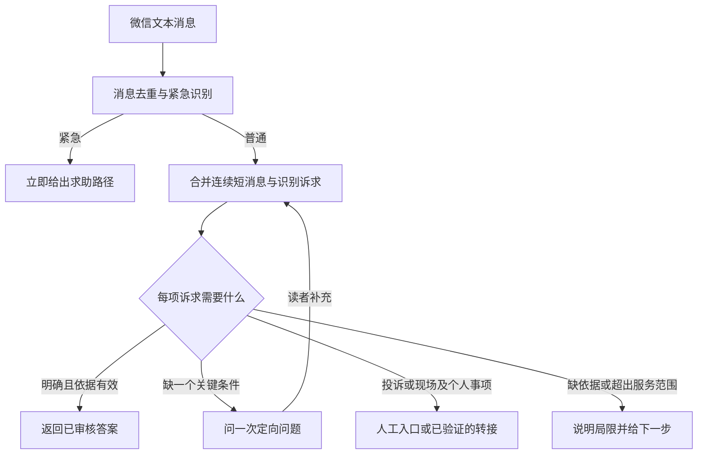
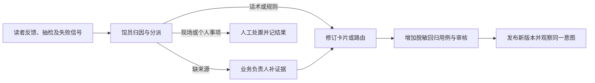

# 图书馆智能客服设计提案

## 1. 推荐方向

**首期用意图路由、馆员审核的标准答案和人工处理入口。RAG 保留为离线对照，只有在合格答复覆盖率有明确增益时，再按主题开放给读者。** 客服的基本任务是判断读者当前需要什么帮助，再决定答复、澄清、联系馆员或提示紧急求助。检索只是其中一种提供答案的方式。

最小版本用本地规则识别明确说法和菜单入口，命中卡片就返回固定正文。模糊请求问一个简短问题，其余展示已核实的联系路径。系统运行范围限图书馆公开信息、自助操作指引和人工衔接。个人借阅状态、账户权限、扣款原因和现场处置由工作人员核实。

这个方案依赖馆员能维护少量答案和联系路径。先指定负责人并试审高频卡片。来源过期、冲突或渠道无人值守时，缩小自动答复范围。上线前由业务负责人确认值班覆盖、紧急联系方式和数据保留期限。

## 2. 读者样本与新版 corpus

[读者样本](Questions.md)有 87 条非空消息。按用户提供的边界，文中有两段连发，分别为第 36–38 行和第 65–66 行。其余非空行分别计为独立样本，共 84 个会话样本。以下是对首期设计有影响的选定主题。手工样本用于确定优先级，线上问题占比留待前向采集估计。

| 主题 | 消息数 | 设计影响 |
|---|---:|---|
| 图书续借 | 14 | 同一规则的多种短写法，优先做一张答案卡 |
| 空间预约及使用 | 13 | 含研讨室、座位、静音舱和占座，空间相关不等于同一答复 |
| 其中，静音舱 | 4 | “舱”“仓”“苍”是可识别异写，目前缺操作依据 |
| 开放时间和 24 小时阅览区 | 7 | 日常时段、具体日期和考试周启用是不同问题 |
| 未明确对象的预约表达 | 5 | 如只说预约或预约时间，先问对象或查看短会话上下文 |
| 明确的图书预约和取书 | 3 | 预约条件、取书点与本人预约状态分开处理 |

新版 `rag-poc/corpus/` 共 11 份 Markdown。新增样本覆盖以这批资料为准。馆网服务项目页面的在线请求跳转后超时，本次依据仓库快照梳理。发布时由馆员复核线上菜单、规则适用范围和时效。

| 状态 | 证据与处理 |
|---|---|
| 有可审内容 | 图书续借、常规开放时段、自助借还、查看借阅记录、研讨室与座位预约、打印和分校区联系方式。详见首批卡片。 |
| 需要核定口径 | 《图书预约》和《常见问题》写“可出借册数少于 0 册”，同句又解释为全部外借。《服务项目》提到已预借但尚未借出也可预约，且按校区区分取书点。由流通业务负责人核对规则和实际界面，再分别发布预约条件与取书卡片。现有材料可供核对，审定前按到馆通知或服务台引导。 [预约短文](../rag-poc/corpus/1.%20图书预约.md) · [常见问题](../rag-poc/corpus/0.%20常见问题.md#书刊借阅-15) · [服务项目](../rag-poc/corpus/0.%20服务项目.md#预约图书) |
| 有规则，缺当前状态 | 考试周开放规则有依据。本次启用日期需核对当期公告。账号/旧证能否使用、预约失败、扣款及个人记录需要馆员或读者中心核实。 |
| 缺可执行指引 | 静音舱、储物柜常规操作、饮水机和信息空间位置、密集书库到达路线，以及虚拟图书馆/知网的具体入口。名称出现在简介或机构职责里时，仍需补入口、地点、适用条件或现场服务指引。 |

## 3. 微信会话与路由

1. **接入和上下文。** 按微信账号和 `MsgId` 对重投去重。非紧急文本可在回调确认后等最多 2 秒，将同一用户的连续短消息按顺序整理成一次请求。保留上一次澄清所需的最小上下文，建议空闲 5 分钟过期。明确的新主题可独立回答。同一批消息中若有两个独立问题，分别判断动作后合成一条可读回复。紧急消息立即处理，取消该会话尚未发出的普通答复。2 秒和 5 分钟为试点参数，需用授权手机场景校准。
2. **判定诉求。** 用菜单入口、归一化别名和高精度规则提供候选，保留否定、失败、投诉等语义。如“怎么预约”和“预约不了”应走不同路径。无法唯一判定时用自然语言追问，给出明确选项。单独收到数字时，只有同会话仍有编号选项才解释为选择。只有当离线测试证明改进，且渠道数据处理范围已经批准，才考虑用模型把难识别的表达映射到有限意图及字段。模型分类不能跳过后续的适用条件和有效期检查。
3. **给出下一步。** 已审核卡片直接返回正文和必要条件。具体日期、校区或人群影响规则时，用已有上下文补齐，否则只问一次，仍不清楚就列可选入口。正文优先给可以执行的第一步，再补限制或来源。简单问候给简短服务入口。无公开依据时说明缺什么，尽量给能核实的渠道。
4. **处理高优先级和人工事项。** 被困、受伤等先给立即联系现场值班或紧急求助的指引，再询问校区和具体位置。占座、噪声、空调和设备故障按现场处置引导，避免让读者等待公众号回复。扣款争议和账号异常给核验入口，公众号对话里不索取密码、验证码、人脸照片或证件号。转接状态区分「提供人工渠道」「请求转接」「馆员确认接单」「馆员确认结案」，回复只描述已经发生的动作。
5. **验证微信人工衔接。** 首期展示已核实的当班渠道。微信原生 `transfer_customer_service` 通过回调响应转交当次消息，并需要账号权限与客服接入。它与回调确认后的异步答复是两条路径。若使用原生转接，先用授权账号验证云托管是否透传响应、馆员能否看见消息、断线或无人接单时读者看到什么。普通消息可按官方异步答复机制设计，确认与出站结果分别记账。5 秒是微信被动回复文档的约束，云托管实测与渠道预算单独记录。 [服务号被动回复](https://developers.weixin.qq.com/doc/service/guide/product/message/Passive_user_reply_message.html) · [服务号转发客服](https://developers.weixin.qq.com/doc/service/guide/product/kf/forwarding.html)

| 输入场景 | 可接受行为 |
|---|---|
| 只说续借 | 返回审核过的续借步骤和关键限制 |
| 只说预约，随后补充是静音舱 | 第一次确认对象。补充后承认缺操作指南，给可核实入口 |
| 连续反馈储物柜识别和照片提交失败，最后表达不满 | 看成一次设备故障反馈，承接前两条信息并引导现场协助 |
| 先说投诉，再说明噪声 | 记录为一次投诉诉求，给现场处理路径，避免评价涉事人的身份或仅复述规则 |
| 已预约座位被占 | 提供可执行的现场帮助路径，保持事件未解决状态直到有明确处置结果 |
| 问逾期费如何交 / 质疑一笔扣款 | 前者按审核的缴费流程答复。后者由服务台查账 |
| 问晚上何时闭馆 / 问今晚是否临时闭馆 | 常规问题给开放时段。查询当天变动要查看已审核的当日公告，缺少公告覆盖或校历信息时给核实渠道 |
| 读者明确表示被困 | 立即发已核实的紧急指引。无可用通知接口时只指引读者自行求助，保持人工接单状态未知 |

## 4. 离线测试与 RAG 的去留

用同一版审核语料、同一套紧急与人工规则、同一批冻结案例比较三种答复路径。

| 方案 | 运行方式 | 判定用途 |
|---|---|---|
| A · 标准答案 | 规则识别并直接取已审核卡片 | 首期上线候选，测可预测的服务覆盖率和路由缺口 |
| B · 文档 RAG | 通过相同的客服路由后，公开咨询交由更新过的文档检索与生成 | 衡量文档正文的长尾覆盖和来源或规则错误的频率 |
| C · 标准答案加 RAG | 标准答案优先，只有无卡片、已明确且主题准入的公开咨询进入 RAG | 测增量质量、成本与时延，决定是否逐主题启用 |

标注全部 84 个样本的会话边界、主副诉求、预期动作和缺口，供需求盘点。用脱敏改写或合成问题整理至少 40 个初始评估案例，另加样本不足的高优先级反例。每个用例固定消息次序、间隔、校区/日期等前提、预期动作、必含事实和禁止断言，注明证据修订版和段落。相同原始会话和近重复表达留在同一组。全新措辞的已知业务和没有答案卡的长尾各自统计，避免将卡片正文或调参时看到的原句放进盲测。上线前补录馆员未参与规则配置的一批新案例。

| 检查 | 首期建议门槛 |
|---|---|
| 紧急、投诉、个人状态、过期或冲突来源 | 冻结集这类案例全部走安全动作。任何错误安全承诺、重大规则误答或错误送达声明均阻断发布 |
| 答复事实、限制与依据 | 可答案例至少 90% 同时通过动作、事实与来源审核。展示分子和分母，附上每个失败场景 |
| 多轮与渠道 | 短消息归并、一次澄清、混合诉求、旧上下文过期、重复回调、回复失败、断线恢复和人工不可用都要实测。重复回调不能重复发答复，接口接受不等于手机送达 |
| 时延与成本 | 分开记录回调确认、读者首条有效回复和外部调用成本，报告 p50/p95。试点建议非紧急自动答复从首条消息到接口接受 p95 ≤ 5 秒，并用授权手机验证实际接收。紧急场景跳过合并等待 |
| RAG 的准入 | 拟开放主题在至少 20 个独立、当前来源可答且没有现成卡片的盲测案例中，相对 A 净增至少 5 个完整正确答复，满足上述安全与时延要求。馆员同时对新增卡片的维护量和 RAG 误答检查量记一次工时。样本不足时继续离线积累 |

将检索漏召回、引用没有支持所答事实、模型生成错误、路由错误、来源过期和发送失败分别记账。离线报告固定语料、答案卡、测试集和系统版本。RAG 额外记录模型、提示词、索引设置和命中的来源。先用同一快照比较，页面内容变更后更新证据并重跑受影响的场景。此前的 [RAG 数据集与测试方案](RAG-DATASET-TEST-PLAN.md) 可复用脱敏、审核和评估数据契约。旧四文档基线保留用于历史复现。

## 5. 监测、反馈与看板

首期用权限受限的运营表格。首页按日绘制请求数和发信失败率折线，显示版本切换日期。按近 7 天意图次数绘制横向条形图，点选意图后查看脱敏归因和关联卡片。待处理表按严重程度和等待时间排序。协作需求稳定后，沿用同一数据字段接入已有的登录环境。试点用一个失败样本验证从进入看板到发布新版答案的全过程。

| 看板区 | 显示内容 | 处理动作 |
|---|---|---|
| 服务运行 | 按日显示请求数、回调/发信错误数、首条回复时延、重复投递数。筛选版本和结果 | 技术负责人查发信异常。持续失败时关闭自动回复并确认人工入口可用 |
| 答复质量 | 按意图显示已答、澄清、无依据及人工导流计数，附馆员抽检通过率、读者有用/未解决/未知及其样本量 | 值班馆员回看失败样本。高频误路由补别名或反例，缺证据建补资料任务 |
| 人工待处理 | 在已验证转接接入后，按严重程度、队列、负责人、待接单时长、接单状态和结案原因筛选 | 紧急和重大误答立即通知已验收的值班渠道。普通事项按值班约定处理 |
| 知识维护 | 待补资料、冲突、即将到期、关联问题次数、负责人、答案及来源版本 | 业务负责人确认口径和有效期。每周看高频缺口与到期项 |

统计单位用归并后的请求。动作比率以已处理请求为分母。读者有用率以实际反馈数为分母，另报反馈覆盖率。馆员抽检以被审核的回复为分母。读者未再追问只能作为行为信号，记为解决状态未知。对重复追问、人工导流、实际接单和结案分别计数。微信客服接口返回成功只表示接受发送请求。

反馈入口可从试点的一句短提示起步，例如请回复「有用」或「未解决」。仅在紧随该答复的有效会话中关联，紧急消息与需要专注处置的投诉不附提示。内部按案例选择问题类型和建议修复项。馆员检查普通抽样、全部公开规则严重错误和负反馈。

运行事件至少含随机请求 ID、时间、主意图和附加动作、决策原因、卡片/来源及版本、发布版本、各阶段时延、发送结果和人工状态。看板聚合按主意图计一次，附加动作独立展示。运营明细与原始消息的访问权限分开。正文、OpenID、个人账户信息与证件或人脸材料不得进入指标标签、共享看板、Git 和评估导出。受限复核原文只在馆方批准的保存期与访问范围内使用。新增长期可审计记录限脱敏评审结论、发布记录和数据定义。

## 6. 标准答案的格式、首批草案与维护

以一个可独立回答的业务问题建卡，编号与读者写法分开。馆员维护表格，发布为经过校验的版本化快照。每张卡包含 `answer_id`、意图、同义说法、易混反例、适用条件（校区、人群、时段）、答复正文及官方链接、证据标识与修订版、有效起止、负责人、复核人、状态和配套测试例 ID。状态为草稿、获批和停用。临时公告用有起止时间的明确覆盖，按校区和服务匹配。缺少必要的生效信息或同范围仍有冲突时，走核实路径。只发布当前有效且审核通过的版本。

以下回复均为**馆员待审草案**。优先复核当期入口、适用校区和电话。

| 卡片 | 可送审的回复或处置 |
|---|---|
| 图书续借 | “在汕头大学图书馆服务号绑定账号后，进入‘个人中心 → 读者中心 → 我的借阅’，选择图书并点击‘续借’。也可从图书馆主页进入读者中心办理。每本可续借一次，续期 15 天。已逾期或已被他人预约的图书不能续借。” [图书续借](../rag-poc/corpus/1.%20图书续借.md) |
| 常规开馆时间 | “图书馆日常开放时间为 8:00–22:00。寒暑假通常周二、周四、周六开放，时间为 9:00–17:00。查询某一天的开放情况，请以对应校区的当期通知为准。” 24 小时阅览区另建卡，区分考试周规则和本期启用日期。 [开馆时间](../rag-poc/corpus/1.%20开馆时间.md) |
| 研讨室预约 | “校内师生可在图书馆服务号的‘个人中心 → 研讨室预约’办理，也可从馆网进入预约系统，登录 MySTU。寒暑假暂停开放。” 预约限制、签到、取消与失败按读者具体问法另答。 [研讨室管理规则](../rag-poc/corpus/0.%20规章制度.md#图书馆研讨室管理规则) |
| 座位预约 | “在图书馆服务号进入‘个人中心 → 空间预约’，选择‘座位’。也可以到馆后扫描空闲座位上的二维码选座。” 占座投诉走现场处置路径。 [座位管理规则](../rag-poc/corpus/0.%20规章制度.md#座位管理系统使用规则) |
| 自助借还与借阅查询 | “选好书后，可到二楼自助借还书机办理借书或还书，离开前请核对屏幕上的办理结果。查看已借图书可进入图书馆读者中心的‘我的借阅’。” 由馆员按校区确认借还点和当前查询入口。 [服务项目](../rag-poc/corpus/0.%20服务项目.md#图书借还) · [常见问题](../rag-poc/corpus/0.%20常见问题.md#书刊借阅-15) · [图书续借](../rag-poc/corpus/1.%20图书续借.md) |
| 打印与复印 | “馆内文印室提供自助打印、复印和扫描。请按机器提示操作，使用一卡通付费。” 具体楼层位置待馆员按校区确认。 [常见问题](../rag-poc/corpus/0.%20常见问题.md#复印打印及扫描-1) |
| 联系服务台 | “桑浦山校区服务台电话是 0754-86502958，东海岸校区服务台电话是 0754-86502999。” 紧急求助使用单独审核的值班路径。 [联系我们](../rag-poc/corpus/0.%20联系我们.md) |

图书预约与取书列为「口径待核」。静音舱列为首批「缺官方入口及规则」，由空间业务负责人补齐。储物柜、饮水机和馆内位置需求各自开一项资料任务。发生投诉或个案时可沉淀处理话术和可核实入口，具体处置保留在人工流程。

值班馆员每周按「业务影响、出现次数、可核实性」排优先级。业务负责人核实来源，复核人确认正文和反例，技术负责人对变更后的卡片执行相关回归后发布。严重错答或临时变更可立即停用受影响卡片并指向核实渠道。回退旧快照前仍须检查生效状态，避免恢复过期公告或撤回的规则。

## 7. 试点交付顺序

1. **离线试点。** 用一份馆员审核表完成首批卡片、标签和测试快照。先比较规则加固定答案与 RAG 对照，保存分主题结果。现有 Python 和本地表格即可支持规则评估。RAG 对照使用现有 embedding 和生成服务凭据，输入限合成或审核过的脱敏样本。交付物包含版本化的卡片、案例和报告，即使微信试点延后也可供馆员使用。
2. **微信影子验证。** 用已授权文本验证归并、路由、时延、反馈归因及看板聚合。系统产出拟答和指标，馆员验证结果。用内部测试账号实测出站、两个校区联系入口和人工可用性。使用现有公众号与云托管权限。若启用独立回调接收器，按前向采集方案验证鉴权、可达性和重投。 [前向采集方案](RAG-DATASET-TEST-PLAN.md#phase-2--prospective-wechat-intake)
3. **有限范围上线。** 值班与渠道验收通过后才开放自动答复。每日抽检，错误命中时先停对应卡片，渠道或整体质量故障时关自动回复并确认人工路径。优先把积累下来的高频长尾加为卡片，达到 RAG 准入门槛的主题可独立试点。若外部模型不可用，该主题回到已审核卡片、澄清或联系路径。流量上涨时先观察等待发送的请求、入站/出站错误和馆员积压，根据实测决定是否增加持久队列或共享看板。

本提案已核对本地问答样本、语料和微信官方文档。微信实际转接、值班接通率、当前馆网菜单和 RAG 对照分数均需按上述试点验证。
