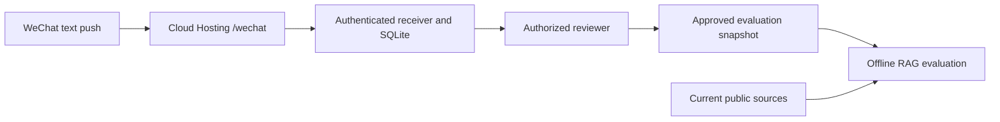

# RAG dataset and testing plan

The four-document RAG baseline is kept for reproducibility. The broader customer support pilot reuses this document's corpus manifest, evaluation split, redaction, and intake contracts. It adds `emergency` to `expected_action` and ordered `turns` for multi-message cases. Its release gates and channel modes are defined in the [customer support design](LIBRARY-SUPPORT-DESIGN.md). The thresholds below retain their original scope as diagnostic gates for the initial RAG baseline.

## Recommendation

Start with a hand-labeled set and the existing LlamaIndex PoC. Use Baserow as the browser editor if library staff want a shared review queue. A UTF-8 CSV edited in a local spreadsheet is enough for the first round and uses the same columns. Export reviewed cases to versioned JSONL so a run can be repeated against the same questions and document versions. The listener adds candidate questions after the baseline exists. The library's public documents remain the source of answer evidence.

| Tool | Good fit for this project | When to choose it |
|---|---|---|
| Baserow | Staff can enter and edit rows in a spreadsheet-style grid, filter a review queue, and export the approved view. Self-hosting and a scoped REST API are available. | Use the signed-in grid when several staff need to review and maintain cases. [Grid](https://baserow.io/user-docs/guide-to-grid-view) · [Filtered export](https://baserow.io/user-docs/export-a-view) · [Hosting](https://baserow.io/user-docs/set-up-baserow) · [API](https://baserow.io/user-docs/database-api) |
| Langfuse | Manual dataset entry, CSV upload, structured expected output, and experiments against the existing RAG. | Choose it if comparing runs and inspecting traces is the main pain point. Import only synthetic or approved de-identified examples. [Datasets](https://langfuse.com/docs/evaluation/experiments/datasets) |
| Dify | Document and chunk management, metadata, and a built-in retrieval test. | Choose it only if staff need to own the knowledge base and its retrieval pipeline in a browser. Current LlamaIndex settings and scores would need a new baseline. [Documents](https://docs.dify.ai/en/cloud/use-dify/knowledge/manage-knowledge/maintain-knowledge-documents) · [Metadata](https://docs.dify.ai/en/cloud/use-dify/knowledge/metadata) · [Retrieval Test](https://docs.dify.ai/en/cloud/use-dify/knowledge-base/test-and-tune) |

Use a local spreadsheet for Phase 1. Add Baserow if staff need shared browser editing, on a separately provisioned host or an approved hosted workspace. The last recorded service-host snapshot had 4 vCPUs, about 7.75 GiB RAM, about 1.27 GiB available, and no swap. It is one observation, so check available memory under representative load before placing any editor or evaluation platform on that host. [Host snapshot](RAG-PROGRESS.md#评估范围与机器快照)

## Dataset structure

| Collection | Record unit and fields | Use |
|---|---|---|
| `corpus` | One revision of an official source per record. `doc_id`, `revision`, `title`, `source_url`, `relative_path`, `effective_from`, `effective_to`, `status`, `checked_on`. Keep the Markdown, TXT, or text-readable PDF alongside the manifest. | Start with the four existing documents after checking that each is current. Index approved revisions only. Keep archived and future revisions outside the input folder. If two current sources disagree and their scopes do not resolve the conflict, have a librarian settle it or label the case for staff. |
| `eval_cases` | One reviewed question per row. `case_id`, `question`, `topic`, `origin` (`synthetic` or `wechat_redacted`), `intent_group`, `split` (`dev` or `holdout`), `expected_action`, `required_facts`, `evidence_refs`, `review_status`. | Score paraphrases by the facts they convey and the evidence they cite. Every `answer` needs required facts and evidence. `clarify` needs the missing detail, `abstain` needs the reason evidence is insufficient, and `staff` needs the reason staff action is required. Put these in `required_facts` as review criteria. |
| `inbox` | One inbound text delivery per row. `event_key`, `received_at_utc`, `text`, `review_status`, `expires_at`. | Restricted SQLite on the user's server. A reviewer selects a recurring need or a failure worth testing, rewrites it without identifying details, and copies the cleaned question to `eval_cases` as a draft. Raw text, message keys, OpenIDs, and exact timestamps stay out of evaluation exports, Git, logs, and model calls on this path. |

Evidence references use `doc_id` + `revision` + a section heading or PDF page. The gold set uses these references instead of generated chunk IDs, which can change when splitting changes. If a question needs multiple facts from different sections, mark every required reference. A single topic can have several `intent_group` values. Keep paraphrases of the same intent and policy scenario in one split to prevent leakage.

A synthetic `answer` example is `借来的书最多能续借几次？`. The reviewer fills in the number and any preconditions from the current renewal section and links that exact revision. `请帮我撤销这笔罚款` is `staff` even when a fines policy exists. `今天开到几点？` is `clarify` if the applicable location is genuinely unclear from the question. `今天的馆际互借申请处理到哪一步了？` is `staff` because the answer depends on a personal record. An unrelated question or one that lacks a public answer and needs no staff action is `abstain`.

## Phase 1 · Manual baseline

1. Verify the active source documents against the library site or official account before indexing. Add a temporary index smoke check for each source so critical numbers, conditions, and section boundaries survive extraction. Use the existing `index --corpus … --index-dir …` and `query --index-dir … --top-k 4 --min-score 0.2` commands from `rag-poc/` with synthetic inputs and a scratch index directory. Keep the deployed index intact.
2. Hand-label 40 cases as a starting target. Use roughly 24 `answer`, 6 `clarify`, 5 `abstain`, and 5 `staff` cases. Include ordinary Chinese phrasing, typos, paraphrases, policy exceptions, multi-section answers, complaints, and near-topic questions the corpus cannot answer. Include both obvious out-of-scope and plausible but unsupported questions. Split 20/20 by `intent_group` with each action represented in both sets. Freeze the first holdout export before tuning. Grow it with fresh groups if holdout findings influence tuning.
3. Use the signed-in Baserow grid or a local spreadsheet to add cases. Keep Draft and Approved views. Use one row per case, with arrays of facts and references entered one per line. Export Approved to CSV and normalize arrays and stable IDs to JSONL. Validate duplicate IDs, evidence against the corpus manifest, enum fields, required review criteria, and split overlap before accepting an export. Commit approved synthetic cases and public source metadata with the snapshot. Include de-identified reader-derived cases only if the approved release scope permits it. Keep draft work and all raw data outside Git.
4. For each case, record raw top-K matches and scores, matches after filtering, the actual action and citations, whether generation ran, and latency. Save the corpus and eval snapshot identifiers, embedding and chat model IDs, prompt/code revision, chunk settings, and score cutoff with each run. Add a small Python evaluator against the existing retrieval and responder code. Report retrieval and generation results per case with an explicit error outcome for provider failures. A librarian scores each required fact and citation against the selected source, then records action and pass/fail. Report embedding, retrieval, and generation timings separately where available, with p50 and p95 as descriptive figures. Compare variants on `dev`, change one setting at a time, and run the chosen configuration against the frozen holdout.

| Check | Proposed first-round gate |
|---|---|
| Retrieval | At least 11 of 12 answerable holdout cases contain all required evidence in the four retrieved chunks. Also report the count after the cutoff and score distributions for unsupported questions. If the group split yields a different total, use at least 90% and report the numerator and denominator. |
| Answers and citations | At least 10 of 12 answerable cases state all required facts with supporting citations, or at least 80% for a different denominator. Any materially wrong policy claim or citation to a superseded source fails the round. |
| Action | Every holdout `clarify`, `abstain`, and `staff` case takes the expected action. Report fixed no-evidence abstentions separately from model-generated refusals. A staff outcome can tell the reader to contact staff and must not claim a transfer or resolution that did not occur. |
| Failure handling | Provider errors show up as errors in the report. Report each bad case with its failed stage and rerun the affected cases after the underlying issue is fixed. |

These thresholds are proposed pilot targets. Establish the baseline with the existing CLI's `top-k=4` and `min-score=0.2`. The earlier unrelated probe passed `0.2` and was refused by the model, so both stages need independent measurement. Score whether the response directs the reader to staff when expected. Actual transfer requires a staff handoff integration.

The first holdout measures the four-document pilot only. Before expanding coverage, inventory the missing public library pages and official account articles, confirm which sources are current, and ingest them as a new corpus revision. Review expected actions, facts, and citations against that revision. Some previously unsupported questions may now have answers. Keep the first snapshot for reproducibility, add holdout cases for the new topics, and rerun retrieval, citation, and action gates on the expanded snapshot before relying on those scores.

## Phase 2 · Prospective WeChat intake

The account administrator confirmed `getMsgList` omits unanswered private messages for this account. With auto-reply disabled, the callback acknowledges text and exits before storage. Add collection before that early return. Use the current cloud-internal callback as the source and a restricted authenticated receiver on the user's server as the destination. [Callback code](../app.py#L602) · [Cloud Hosting push setup](https://developers.weixin.qq.com/miniprogram/dev/wxcloudservice/wxcloudrun/src/guide/weixin/push.html)

The SQLite `inbox` supersedes the historical collector as the active raw-question review source. Staff review the protected export from that inbox. Keep the existing `questions.csv` and `sync-state.json` as restricted legacy artifacts under the applicable retention policy. The historical key comes from record fields, while callback deduplication uses the account and `MsgId`. Leave the history timer disabled and keep the legacy rows out of the live inbox. [Historical collector](../README.md#微信历史问题采集一次性-cli)

- Keep public access to the cloud callback disabled. Cloud Hosting forwards text plus a keyed event identifier derived from the configured account and `MsgId`. Both the inbound ID and event key stay strings. The receiver enforces a unique event key and confirms a new or previously committed row. Skip non-text messages. Count missing IDs separately and skip those messages in the pilot so duplicate handling stays deterministic. Only the account-scoped event key travels with the text. Keep the receiver behind a private connection where available or use TLS and a dedicated token with write-only application access. Keep the token and event-key secret in server and cloud secret configuration as appropriate.
- Use a bounded synchronous write through the receiver. Return `success` after durable commit, including when an earlier attempt already committed the same event. Return a retryable error if the receiver fails or times out. Cloud behavior on non-2xx and outages is unverified. Run an authorized receiver-outage test including recovery. If redelivery does not recover the same event, persist a cloud-side outbox and drain it before treating capture as reliable. Restart and deployment must preserve accepted records. Keep auto-reply disabled throughout intake verification.
- Use a protected export from the receiver for the local reviewer to triage periodically. Delete dropped raw items promptly. Set a proposed maximum of seven days for unreviewed raw text, with expiry applied also to exports and backups, subject to the library's retention policy. Have staff confirm the processing and access scope for listening before capturing reader traffic. Staff move only reviewed rewrites into the editor. Labels, evidence checks, and export follow the same Phase 1 workflow. Verify that logs and metrics contain only operational fields. Count accepted rows, duplicates, unsupported messages, failed forwards, and age of the review backlog. If intake outruns labeling, sample repeated intents before export.
- Test with a single authorized synthetic message and no reply. Verify one row reaches the server without OpenID and the phone receives no automatic reply. Replay the same event, exercise non-text and missing-ID deliveries, force a receiver timeout, and restart the receiver after a commit. Verify that a duplicate never creates a second row and that a failed forward remains visible in metrics. Promote one cleaned example from the SQLite inbox, export it, and verify the offline evaluator can read it. Confirm the historical timer is still disabled before cutover. Pause forwarding if the intake path fails acceptance. Previously approved snapshots and the offline workflow remain usable.

The critical assumption for Phase 2 is that WeChat Cloud Hosting can reach the chosen server over authenticated HTTPS within the callback budget. Reachability, retry behavior, and receiver persistence need the scenario above. The implementation uses the existing Python runtime and provider settings, one private receiver process on the user's server, existing cloud/official-account access, a receiver token, and an event-key secret. A Baserow deployment and its editor accounts are optional. Phase 1 can run with the existing embedding and chat credentials and a local spreadsheet. Current planning did not exercise provider calls or live collection.
