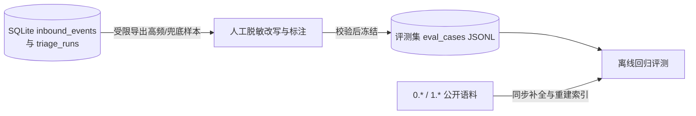

# RAG 数据集与评测方案

> [!NOTE]
> 第 1~3 步已落地 SQLite 留痕（`inbound_events` 7 天过期、`triage_runs`、`staff_cases`、`feedback_records`），见 [Step 2](STEP2-FILTER-AND-MERGE-PIPELINE.md) 与 [Step 3](STEP3-TIER1-AND-TIER2-RAG.md)。本文聚焦第 4 步的**脱敏评测集建设、离线评测口径与首轮验收门槛**，总体分流逻辑见 [系统设计](DESIGN.md)。

## 工具选型

初期直接用**本地 UTF-8 CSV + 表格软件**起步，审核定稿后导出版本化 JSONL 供离线评测复现。多人并行审核再考虑接入外部工具：

| 工具 | 适用场景 | 选型边界 |
|---|---|---|
| Baserow | 多位馆员在线表格协同审核、筛选队列与导出视图 | 仅在需要多人在线审核时部署（自建或托管）。现网宿主机曾测得约 4 vCPU / 7.75 GiB 内存（可用约 1.27 GiB、无 Swap），同机部署前须先压测。 |
| Langfuse | 管理评测集、追踪单次生成链路与对比实验 | 仅用于比较调优实验，禁止导入未经脱敏的真实读者原文或 OpenID。 |
| Dify | 浏览器端托管知识库与检索切片 | 当前链路已基于 LlamaIndex `index_v2` 运行，迁入需重建全部检索基线，暂不采用。 |

## 数据集结构

| 集合 | 核心字段 | 用途与脱敏边界 |
|---|---|---|
| `corpus` | `doc_id`、`revision`、`title`、`source_url`、`relative_path`、`effective_from`、`effective_to`、`status`、`checked_on` | 记录已核对生效的公开资料版本（`0.*` 入 Tier 2 向量库、`1.*` 作 Tier 1 预设答案）；未发布或过期版本不进索引。 |
| `eval_cases` | `case_id`、`question`、`topic`、`origin`（`synthetic` / `wechat_redacted`）、`intent_group`、`split`（`dev` / `holdout`）、`expected_action`、`required_facts`、`evidence_refs`、`review_status` | 评测主表。`expected_action` 取值：`answer` / `clarify` / `abstain` / `staff` / `emergency`（多条连续消息保留有序 `turns`）。 |
| `inbound_events`（SQLite） | `seq`、`received_at_epoch`、`filter_category`、`content`、`expires_at_epoch`（默认 7 天） | 仅作自建服务器内受限入站池。OpenID、原始消息键、精确时间戳及未脱敏正文不得进入评测导出、Git、日志或外呼对比。 |

约束规则：

- **依据绑定版本与小节**：`evidence_refs` 使用 `doc_id + revision + 小节标题`，不绑定易随切分变化的 chunk ID；跨小节作答需列出全部必备出处。
- **防止评测泄漏**：同一 `intent_group` 的不同问法必须同处 `dev` 或同处 `holdout`；`dev` 用于调参，冻结的 `holdout` 仅用于最终对照验收。
- **动作标注口径**：有公开规则可答标 `answer`；合理位置/场景缺关键前提标 `clarify`；需核查个人记录、减免罚款或投诉处置即使有规则也标 `staff`；超范围或缺公开依据标 `abstain`；物理被困或突发安全标 `emergency`。

## 离线评测流程与首轮门槛

1. **校验语料**：核对公开网页与公众号原稿后，运行 `python -m support_backend inspect-chunks` 与 `build-index` 更新 `rag-poc/index_v2/`（若需离线对照，可用 `rag_poc.cli index` 临时建库）。
2. **构建首批题库**：建议起步人工标注 40 题（约 24 `answer`、6 `clarify`、5 `abstain`、5 `staff`），覆盖日常口语、错别字、规则例外、跨节答案、投诉及超范围问题，按 `intent_group` 对半拆入 `dev` / `holdout`。
3. **审核导出**：经本地表格或 Baserow 区分 `Draft` / `Approved` 视图，导出 JSONL 前校验 `case_id` 唯一、枚举合法、出处有效且 `dev`/`holdout` 无交叉，仅将合成题与已核准脱敏改写纳入版本库。
4. **运行评测**：记录原始 top-K 得分、实际触发路由、`source_url` 与小节引用、生成耗时（p50/p95）及接口失败；单次只调整一个变量并在 `dev` 验证后，再跑冻结 `holdout`。

| 检查项 | 首轮验收门槛 |
|---|---|
| 检索召回 | 可答 `holdout` 题至少 `90%`（如 `11/12`）在 `top_k=4` 内包含全部必备依据。 |
| 答案与引用 | 可答 `holdout` 题至少 `80%`（如 `10/12`）答全 `required_facts` 且出处真实有效；出现关键政策错误或引用过期源即不通过。 |
| 动作路由 | `holdout` 中全部 `clarify`、`abstain`、`staff`、`emergency` 走对预期分支；`staff` 只能提示已登记/联系馆员，不得伪称已转接解决。 |
| 异常记录 | 接口超时或异常必须独立记错并支持重跑，不与正常拒答混算。 |

## 线上样本回流闭环（第 4 步）

历史 `getMsgList` 采集脚本与定时任务已废弃移除（若本地留有旧 `questions.csv` 与 `sync-state.json`，按留存策略封存，不并入线上数据库）。当前样本回流直接基于 [Step 1](STEP1-CLOUD-FORWARD-PIPELINE.md) 与 [Step 2](STEP2-FILTER-AND-MERGE-PIPELINE.md) 的实时留痕库推进：

- 优先从 `triage_runs` 与 `staff_cases` 抽取 `tier2_fallback`、`clarify_limit_fallback` 及高频提问，人工去除个人敏感信息并改写为可公开评测的问法后加入 `eval_cases`。
- 原始入站消息正文按 7 天到期策略清理（导出副本与临时备份同步受限与到期删除）；同步根据缺口补充 `0.`/`1.` 语料并重跑回归评测。
